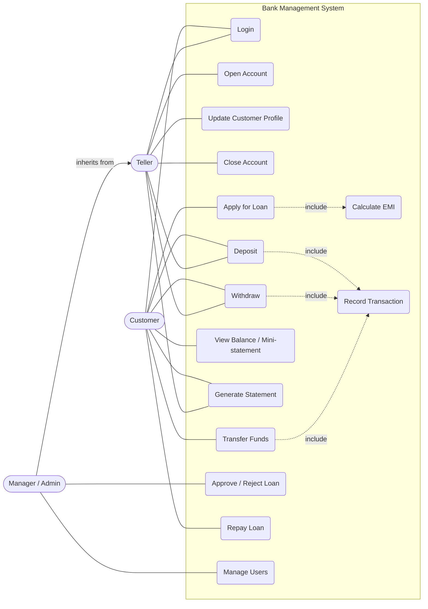
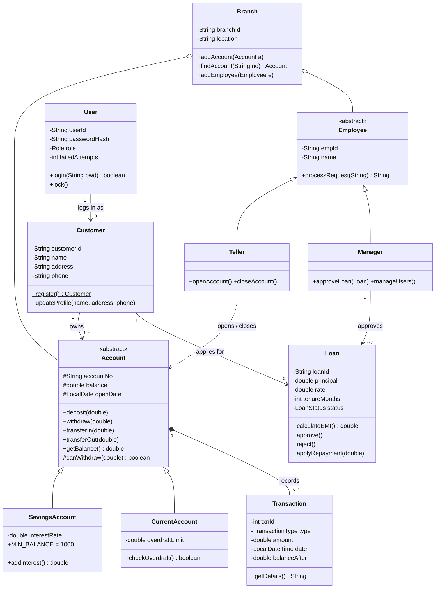
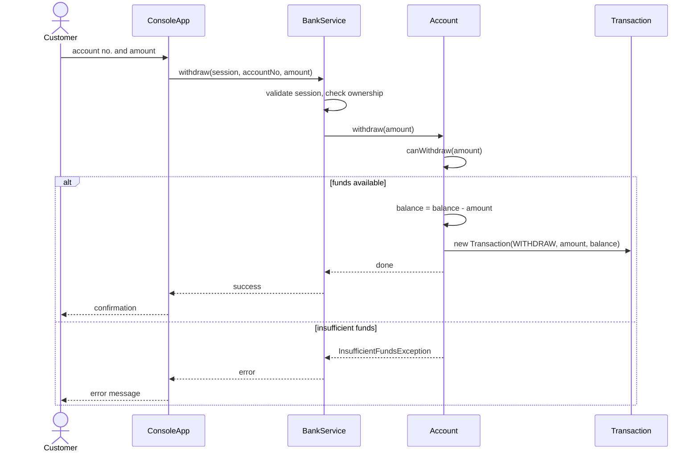
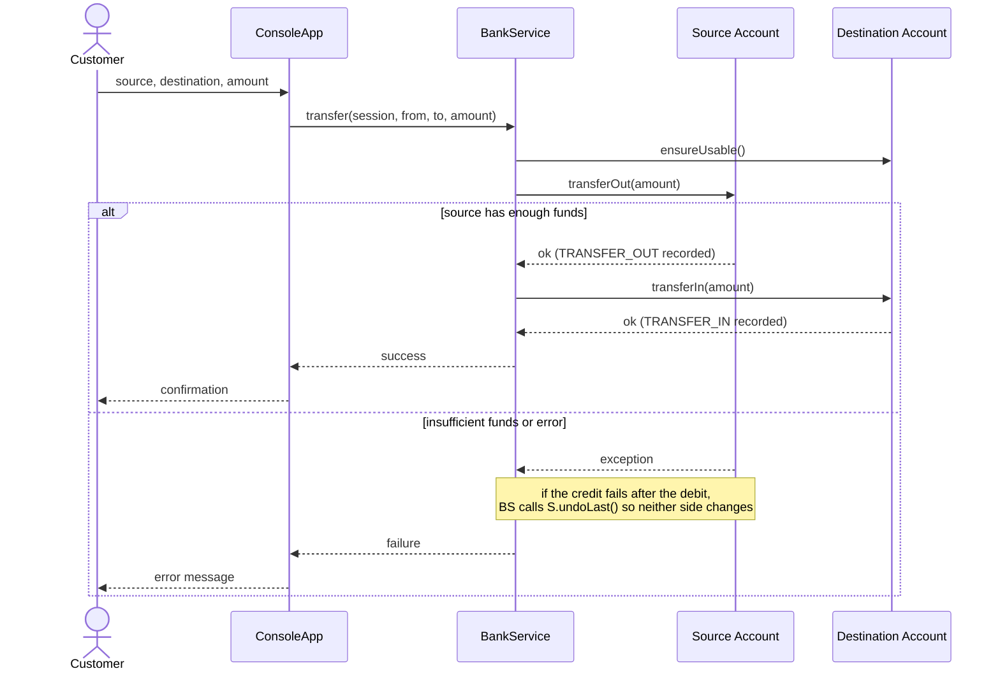
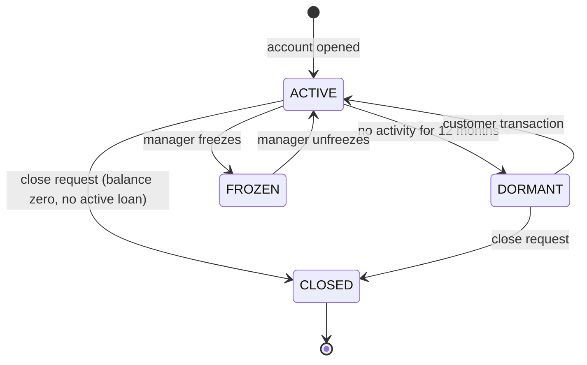
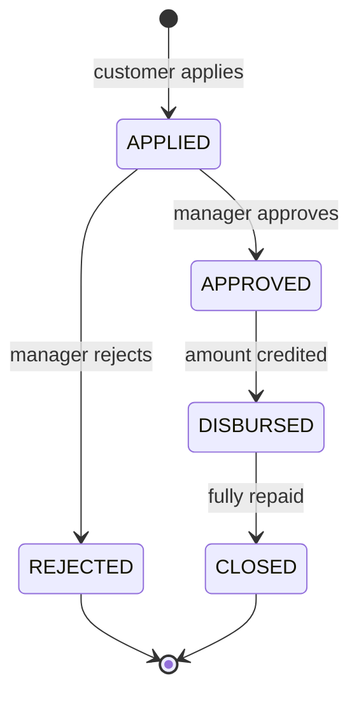
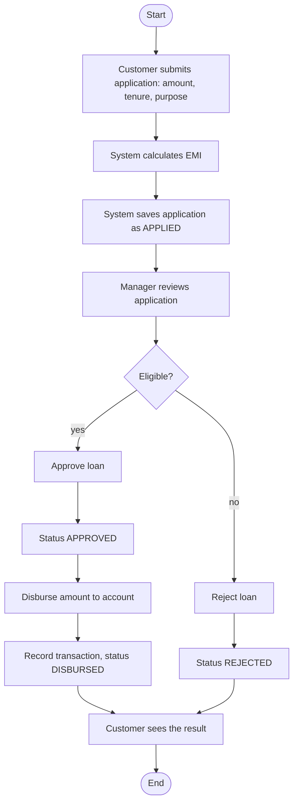

# Design documents

All diagrams are [Mermaid](https://mermaid.js.org/) and render directly on GitHub. They match the code in `src/`.

## Use case diagram

## Class diagram

`BankService` (package `service`) is the single entry point used by the UI. `AccountFactory` creates accounts by type name, `AuthService` handles login and lock-out, `Session` handles the idle timeout and `AuditLog` records critical actions.

## Sequence: Withdraw (UC-2)

## Sequence: Fund transfer (UC-3)

## State diagrams

## Activity diagram: loan approval

## Principles and patterns

| Concept | Where |
|---|---|
| Encapsulation | `Account.balance` is protected. It changes only through `deposit`, `withdraw`, `transferIn`, `transferOut`, which validate every change |
| Abstraction | `Account` and `Employee` are abstract. The service works with "an account" without knowing the type |
| Inheritance | `SavingsAccount`, `CurrentAccount` extend `Account`. `Teller`, `Manager` extend `Employee` |
| Polymorphism | `withdraw()` calls the abstract `canWithdraw()`, which each account type implements differently |
| Factory | `AccountFactory.create("SAVINGS", ...)` so the UI never calls constructors |
| Template method | `Account.debit()` fixes the steps and calls the `canWithdraw()` hook |
| Exceptions | `InsufficientFundsException` (checked), `AccountNotFoundException`, `InvalidLoginException`, `AccessDeniedException`, `SessionExpiredException`, `IllegalArgumentException` for bad amounts |
